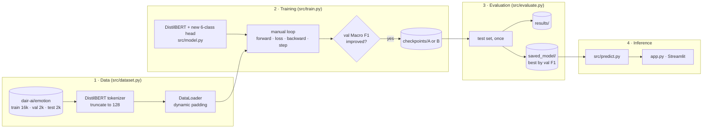
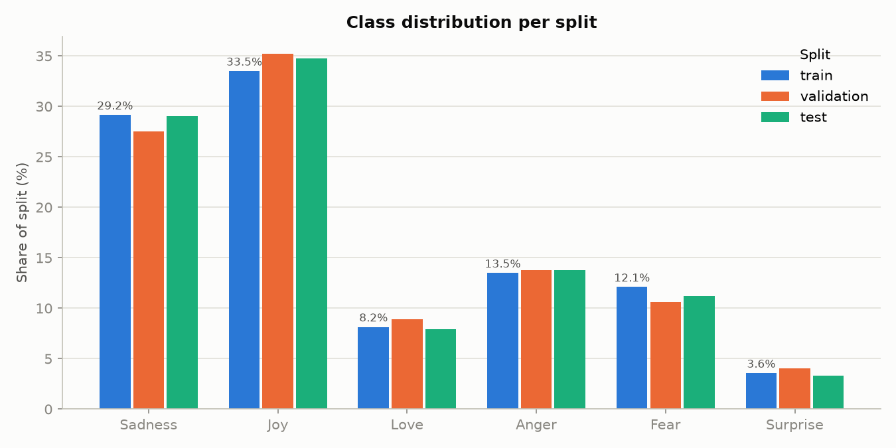
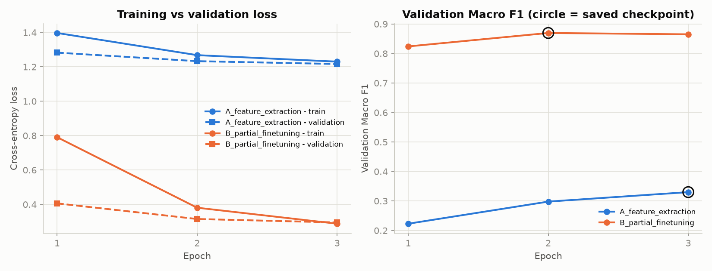
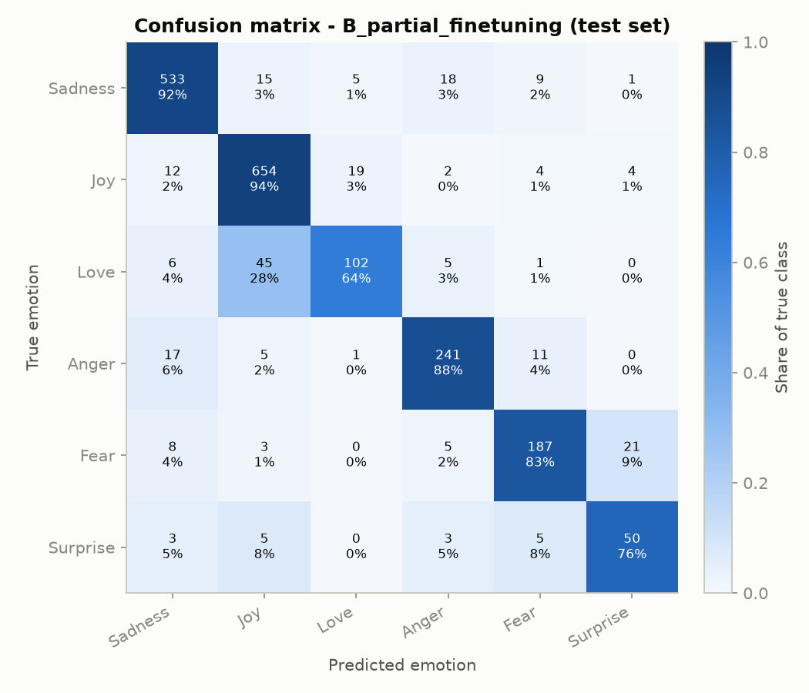
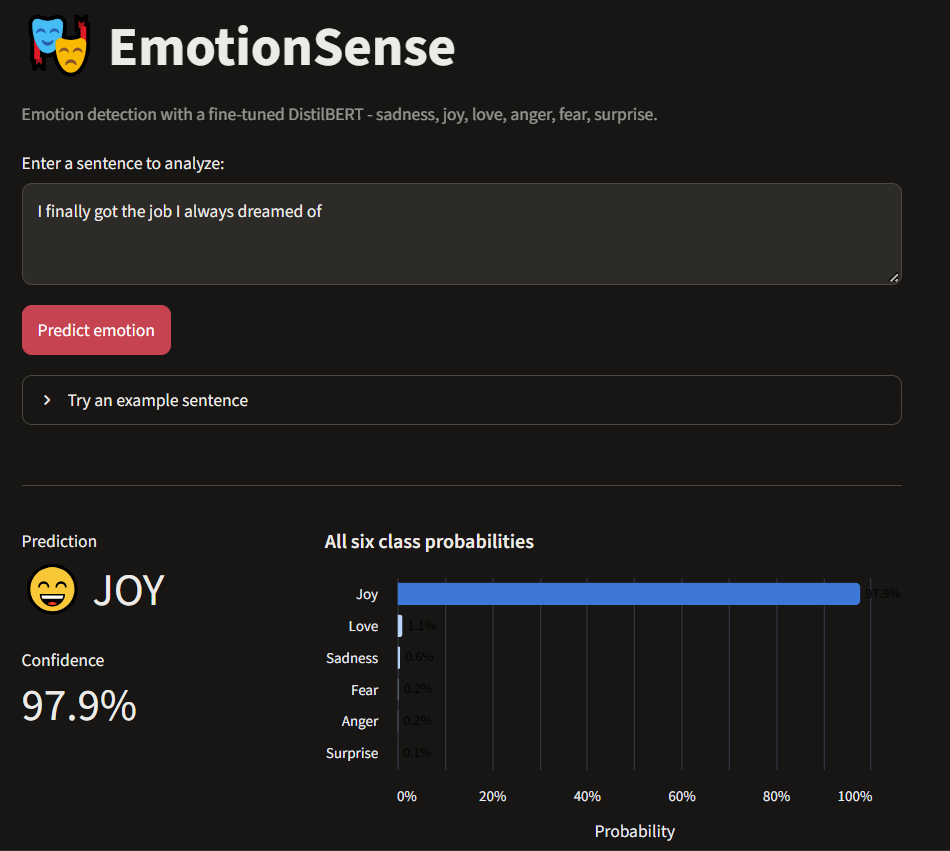
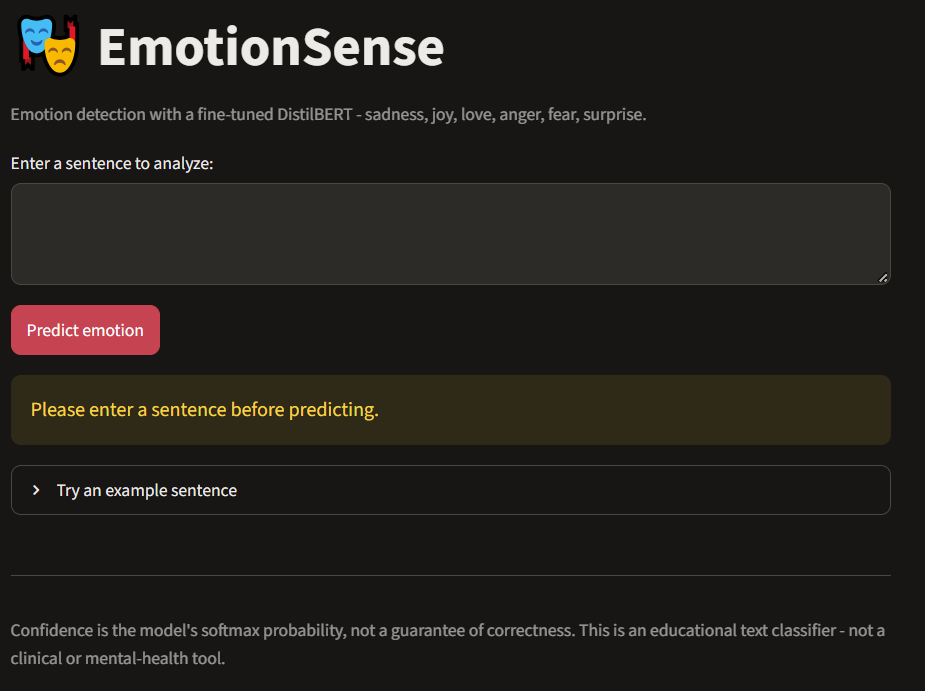

# EmotionSense — Emotion Detection with Fine-Tuned DistilBERT

Classify English text into six emotions (**sadness, joy, love, anger, fear, surprise**) using
`distilbert-base-uncased`, a hand-written PyTorch training loop, and a local Streamlit app.
The project compares two strategies:

| | Experiment A — Feature extraction | Experiment B — Partial fine-tuning |
|---|---|---|
| Backbone | fully frozen | last 2 of 6 Transformer layers trainable |
| Classification head | trainable | trainable |
| Learning rate | 1e-4 | 2e-5 |
| Epochs / batch size | up to 3 / 16 | up to 3 / 16 |
| Checkpoint selection | best validation Macro F1 | best validation Macro F1 |

> New to the concepts? Read [docs/LEARNING_GUIDE.md](docs/LEARNING_GUIDE.md) alongside the code. It explains
> each stage, why it exists, and how the pieces fit together.

---

## 1. System overview



Information flows one way: **data → training → evaluation → inference**. Each stage writes files that
the next stage reads, so you can re-run any stage without repeating the earlier ones.

## 2. Repository structure

```
emotion-detection-pytorch/
├── src/
│   ├── config.py      # labels, hyperparameters, paths, seed/device helpers (single source of truth)
│   ├── dataset.py     # load splits, tokenize, PyTorch Dataset, DataLoaders        (§1.3)
│   ├── eda.py         # exploratory data analysis + plots                           (§1.2)
│   ├── model.py       # build DistilBERT classifier, freeze/unfreeze layers         (§2.1)
│   ├── train.py       # manual PyTorch training/validation loop                     (§2.2)
│   ├── evaluate.py    # metrics, test evaluation, reports, model export             (§3.1–3.2)
│   ├── visualize.py   # all matplotlib figures, one consistent style
│   └── predict.py     # reusable inference function + CLI                           (§3.3)
├── app.py             # Streamlit UI                                                (§4)
├── results/           # headline metrics/plots + eda/ training/ evaluation/ logs/ — committed to git
├── checkpoints/       # best checkpoint per experiment — git-ignored (created by training)
├── saved_model/       # exported best model used by the app — git-ignored
├── docs/              # see docs/README.md for a map
│   ├── LEARNING_GUIDE.md
│   ├── screenshots/   # Streamlit screenshots for the submission
│   └── images/learning_guide/   # diagrams used by the learning guide
├── requirements.txt
└── README.md
```

## 3. Setup

Requires Python 3.10+. An NVIDIA GPU is recommended; training on the CPU works but is slow. From the repository
root, install the CUDA build of PyTorch first, then everything else (on macOS/Linux, activate the environment
with `source .venv/bin/activate`):

```bash
python -m venv .venv
.venv\Scripts\activate
pip install torch --index-url https://download.pytorch.org/whl/cu126
pip install -r requirements.txt
```

For other CUDA versions, or CPU only, pick the matching command at https://pytorch.org/get-started/locally/.

> **GPU gotcha:** CUDA 12.x wheels need an NVIDIA driver ≥ 528. With an older driver,
> `torch.cuda.is_available()` returns `False` and everything silently runs on the CPU. Check with
> `python -c "import torch; print(torch.cuda.is_available())"` before training.

**Tested environment** (the configuration that produced every result in this README):

| Component | Version |
|---|---|
| OS | Windows 10 Home (64-bit) |
| Python | 3.13.7 |
| torch | 2.14.1+cu126 |
| transformers | 5.23.0 |
| datasets | 5.2.0 |
| scikit-learn | 1.9.1 |
| pandas / numpy / matplotlib | 3.1.1 / 2.5.5 / 3.11.2 |
| streamlit / altair | 1.67.0 / 6.3.0 |
| Hardware | NVIDIA GeForce GTX 1650 Ti laptop GPU (4 GB), driver 621.24 |

## 4. How to run (in order)

| Step | Command | Produces |
|---|---|---|
| 1. Explore the data | `python -m src.eda` | `results/eda/` (class distribution, token lengths, `eda_summary.json`) |
| 2. Train both experiments | `python -m src.train` | `checkpoints/A_*`, `checkpoints/B_*`, `results/training/*_history.json` |
| 3. Evaluate on test + export | `python -m src.evaluate` | `results/comparison.csv`, `confusion_matrix.png`, `training_curves.png`, `results/evaluation/` (per-class reports, misclassified examples), `saved_model/` |
| 4. Try a prediction (CLI) | `python -m src.predict "I am so excited about tomorrow!"` | printed label + probabilities |
| 5. Launch the UI | `streamlit run app.py` | app at http://localhost:8501 |

Useful options:

```bash
python -m src.train --experiment A     # train only one experiment
python -m src.train --epochs 1         # quick smoke test of the whole pipeline
```

Always run commands from the repository root with `python -m ...`, so that `from src...` imports resolve.

## 5. Key design choices

- **Data (`src/dataset.py`):** the predefined 16k / 2k / 2k splits are never merged. Each split is tokenized once
  (truncation + attention mask), and batches are padded dynamically.
- **Model (`src/model.py`):** each experiment builds a fresh pretrained DistilBERT with a new 6-class head, so
  **B never starts from A's checkpoint**. Layers are frozen with `requires_grad = False`.
- **Training (`src/train.py`):** a plain PyTorch loop with no HF `Trainer`: forward → loss →
  `zero_grad()` → `backward()` → `step()`. Validation runs under `model.eval()` + `torch.no_grad()`, and
  a checkpoint is saved **only when validation Macro F1 improves**. The test split is never loaded here.
- **Evaluation (`src/evaluate.py`):** scores each best checkpoint on the **test set once**, and exports the
  best-by-validation model to `saved_model/`.
- **Inference (`src/predict.py`, `app.py`):** one reusable `EmotionClassifier.predict(text)`. It rejects blank
  input, and its output is the same on CPU and GPU. The Streamlit app reuses it and caches it with
  `st.cache_resource`.

For a step-by-step explanation of every stage, see [docs/LEARNING_GUIDE.md](docs/LEARNING_GUIDE.md).

---

## 6. Results

All numbers below are copied from files generated by the actual runs: `results/comparison.csv`,
`results/training/*_history.json`, `results/evaluation/classification_report_*.txt` and the logs in `results/logs/`
(see [results/README.md](results/README.md) for a map of the folder).

### 6.0 EDA findings (`python -m src.eda`)

| Check | Finding |
|---|---|
| Splits / columns | 16,000 / 2,000 / 2,000; columns `text`, `label`; label names match `0 sadness … 5 surprise` |
| Null / empty texts | none in any split |
| Duplicate texts | 31 in train, 2 in validation, 0 in test - and 30 of the 31 train duplicates carry **conflicting labels** (direct evidence of label noise) |
| Overlap with train | 5 validation and 11 test texts also appear in train (< 0.6 %, negligible) |
| Length | 19.2 words / 22.3 tokens on average, 95th pct 45 tokens, max 87 → `max_length=128` truncates **0** texts |
| Label balance (train) | joy 33.5 %, sadness 29.2 %, anger 13.5 %, fear 12.1 %, love 8.2 %, surprise 3.6 % → **9.4× imbalance** |

All three splits have almost identical class proportions, so validation scores are a fair proxy for test scores.

### 6.1 Test-set comparison (checkpoints selected on validation Macro F1)

| Model | Accuracy | Macro Precision | Macro Recall | Macro F1 |
|---|---|---|---|---|
| A: Feature extraction | 0.5455 | 0.4704 | 0.3220 | 0.3065 |
| B: Partial fine-tuning | **0.8835** | **0.8371** | **0.8281** | **0.8304** |

Per-class test F1 (from `results/evaluation/classification_report_*.txt`):

| Model | sadness | joy | love | anger | fear | surprise |
|---|---|---|---|---|---|---|
| A | 0.596 | 0.688 | 0.025 | 0.255 | 0.276 | 0.000 |
| B | 0.919 | 0.920 | 0.713 | 0.878 | 0.848 | 0.704 |

### 6.2 Efficiency

| Model | Trainable params | Total params | Training time (3 epochs) | Best epoch | Best val Macro F1 |
|---|---|---|---|---|---|
| A: Feature extraction | 595,206 (0.89 %) | 66,958,086 | 144.6 s (2.4 min) | 3 | 0.3301 |
| B: Partial fine-tuning | 14,770,950 (22.06 %) | 66,958,086 | 224.1 s (3.7 min) | 2 | 0.8696 |

### 6.2b Per-epoch validation history

| Epoch | A train loss | A val loss | A val acc | A val Macro F1 | B train loss | B val loss | B val acc | B val Macro F1 |
|---|---|---|---|---|---|---|---|---|
| 1 | 1.3969 | 1.2826 | 0.5200 | 0.2230 | 0.7909 | 0.4060 | 0.8570 | 0.8241 |
| 2 | 1.2680 | 1.2330 | 0.5495 | 0.2979 | 0.3809 | 0.3151 | **0.8975** | **0.8696** ✔ |
| 3 | 1.2301 | 1.2165 | **0.5615** | **0.3301** ✔ | 0.2878 | 0.2951 | 0.8970 | 0.8651 |

✔ = checkpoint kept. B's epoch-3 Macro F1 dipped slightly, so the epoch-2 weights were kept and exported -
validation-based selection at work.

### 6.3 Figures

| Class distribution | Learning curves | Confusion matrix (best experiment) |
|---|---|---|
|  |  |  |

## 7. Error analysis

Experiment B misclassified **233 of 2,000** test texts. All of them are in
`results/evaluation/misclassified_examples.csv`, sorted by confidence (most confident mistakes first). The examples below
come from that file, chosen to cover different kinds of failure.

| # | Text (test set) | True | Predicted | Conf. | Plausible reason |
|---|---|---|---|---|---|
| 1 | "i feel underappreciated and under valued" | joy | sadness | 0.991 | **Label noise.** The text is clearly negative, so the model's answer is arguably the correct one. The automatic hashtag-based labelling assigned *joy*. |
| 2 | "i feel very cheated since i am supporting the family and doing all the other stuff while he spends hours a day gaming" | joy | sadness | 0.984 | **Label noise.** "Cheated" and the complaint are negative. A human would say anger or sadness, not joy. |
| 3 | "ive been feeling from my adoring fans … i felt brave and excited and ventrured forth with guitar in hand to a local open mic night" | love | joy | 0.996 | **Love vs joy boundary.** "Excited" and "brave" are strong *joy* words, and the love cue ("adoring") is weak and early. This is the most common confusion overall (45 love texts predicted as joy). |
| 4 | "i hate these feelings in my heart i hate that work stressed me out … im frustrated lord" | sadness | anger | 0.980 | **Lexical cues of another emotion.** "Hate" ×3 and "frustrated" are anger words. The sadness underneath is only implicit. |
| 5 | "i grabbed my dog and hugged her fiercly … have been feeling rather depressed anxious all day" | fear | sadness | 0.990 | **Mixed emotions.** The text names both "depressed" (sadness) and "anxious" (fear). A single-label dataset forces one answer. |
| 6 | "i was stressed about my job search and apartment hunting and i was just feeling overwhelmed with everything" | fear | surprise | 0.780 | **Ambiguous keyword.** "Overwhelmed" occurs in both fear and surprise texts. This is the second-largest confusion (21 fear texts predicted as surprise). Note the lower confidence. |
| 7 | "i can choose to tell the whole word what im feeling now or just fake it with some happy stories" | sadness | joy | 0.970 | **Surface word vs meaning.** The only explicit emotion word is "happy", but it's used in "fake it with some happy stories", which signals hidden sadness. The model follows the keyword, not the irony. |

**Takeaways:** many of the most confident errors are debatable labels rather than model failures. The real
model weaknesses are (a) the positive *love/joy* boundary, (b) the *fear/surprise* boundary around words like
"overwhelmed" and "weird", and (c) reliance on emotion keywords when the meaning is implied or ironic.

### 7.1 Inference module check (`src/predict.py`)

| Input | Output |
|---|---|
| "I am so excited about tomorrow!" | **JOY 0.9929** (fear 0.0022, surprise 0.0019, anger 0.0011, love 0.0011, sadness 0.0007) |
| "My heart was pounding when I heard footsteps behind me in the dark parking lot." (original) | **FEAR 0.5411** (anger 0.2543, sadness 0.1160, joy 0.0724, …) |
| `"   "` (blank) | `Error: Please enter some text - the input is empty.` (no crash) |
| Same sentence on CUDA vs CPU | identical label and confidence; max probability difference 2.1e-9 |

The footsteps sentence is correct but much less confident. It describes fear through a bodily reaction without
any "i feel …" phrase, a style that is rare in the training data.

## 8. Streamlit app

```bash
streamlit run app.py
```

Screenshots of the running app (in `docs/screenshots/`):




## 9. Reflection questions

**1. What is fine-tuning, and why does pretrained knowledge help?**
Fine-tuning means taking a model that was already trained on a large general task (DistilBERT learned
masked-language modeling on BookCorpus + English Wikipedia) and continuing to train it on a smaller, specific
task. During pretraining, the model learned grammar, word meaning in context, negation, and intensity.
Our 16k labeled sentences could never teach all of that from scratch. Because the model already "understands"
English, it only needs to learn how to map that understanding to six emotions. This needs far less data and
compute than training from scratch.

**2. What changes when the backbone is frozen vs. partially unfrozen?**
*Frozen (A):* DistilBERT acts as a fixed feature extractor. Only the head (≈0.6M parameters) learns, so it can
only combine the generic sentence features that already exist. Training is cheap: no gradients flow through the
backbone, there are fewer optimizer states, and a higher learning rate is safe.
*Partially unfrozen (B):* the last two blocks (≈14M more parameters) can also change, so the model can reshape
its upper-level representations to separate emotions. For example, it can pull apart *fear* and *surprise* even
though they appear in similar contexts. This costs more memory and time per step. It also needs a small learning
rate (2e-5), so the pretrained knowledge isn't destroyed ("catastrophic forgetting"). The lower 4 blocks stay
frozen and keep their general syntax and word-level knowledge.

**3. Which experiment performs better on Macro F1, and why might that be?**
**B, by a wide margin:** test Macro F1 **0.830 vs 0.307** (accuracy 0.884 vs 0.546). The gap is large for
three reasons:
- *Frozen `[CLS]` features are not emotion features.* DistilBERT was pretrained with masked-language modelling,
  and the `[CLS]` vector was never trained to summarise a sentence, let alone its emotion. A's head can only
  re-weight these generic features. B lets the top two blocks reorganise them so that emotions become separable.
- *A was still underfitting.* Its train and validation loss were still falling at epoch 3 (1.23 / 1.22), and
  train loss ≈ val loss means no overfitting, just too little capacity and time under the fixed budget
  (3 epochs, LR 1e-4, linear decay). More epochs or a higher LR would help A, but the assignment fixes them.
- *Imbalance hurts the weak model most.* With weak features, the cheapest way to lower the loss is to predict
  the frequent classes. A predicts joy and sadness for most inputs: surprise recall is **0.00** and love recall
  **0.01**. That is why A's accuracy (0.55) looks much better than its Macro F1 (0.31). Macro F1 exposes this.

The cost of B is modest: 25× more trainable parameters but only ~1.55× the training time (3.7 vs 2.4 min),
because both experiments pay for the forward pass through all 6 blocks, and B only adds the backward pass
through 2 blocks. So partial fine-tuning is clearly worth it here.

**4. Which emotions are most often confused, and what do the mistakes reveal?**
From B's test confusion matrix (rows = true class):

| Confusion | Count | Share of true class |
|---|---|---|
| love → joy | 45 | 28 % of love |
| fear → surprise | 21 | 9 % of fear |
| joy → love | 19 | 3 % of joy |
| sadness → anger / anger → sadness | 18 / 17 | 3 % / 6 % |
| sadness → joy | 15 | 3 % |

- **Love ↔ joy** dominates. Both are positive, and love texts usually *contain* happiness ("excited", "glad").
  Love is also 4× rarer than joy in training, so when the evidence is ambiguous the model falls back on joy.
  As a result, love has the lowest recall (0.64) of any class.
- **Fear → surprise** clusters around words that sit between the two, like "overwhelmed", "weird" and "strange".
  Both emotions are reactions to the unexpected. Surprise is the rarest class (3.6 %), and its F1 (0.70) is
  the lowest.
- **Anger ↔ sadness** happens in texts about being hurt or treated unfairly, which contain both emotions.
- The two weakest classes (love 0.71, surprise 0.70) are the two smallest. The large classes (joy, sadness)
  reach 0.92 F1. So the mistakes reflect **class frequency, overlapping meanings, and keyword-based labelling**,
  and the confident errors in Section 7 show that some "mistakes" are actually wrong labels.

**5. What are the limitations of the dataset and confidence scores?**
- **Dataset:** the labels were created automatically from emotion hashtags/keywords in tweets, so some labels are
  noisy or debatable. Most texts follow a "i feel …" style, so the model may handle other writing styles poorly.
  There is one label per text, but real sentences can express mixed emotions. The classes are imbalanced, and the
  data is English-only, lower-cased, and from social media.
- **Confidence scores:** softmax always sums to 1 over the six classes, even for text with no emotion
  ("The meeting is at 3 pm"). Fine-tuned Transformers also tend to be **over-confident**, so 0.95 does not
  mean "95% chance of being correct" unless the model is calibrated. Confidence is a model output, not a
  guarantee, and this project is not a clinical or mental-health tool.

## 10. Model weights

This is a trial/course project, so the trained weights (~255 MB per checkpoint) are **not distributed**.
They are excluded from git (see `.gitignore`) and are not hosted anywhere else.

To get a working model, **reproduce it**: run steps 2–3 of [How to run](#4-how-to-run-in-order)
(`python -m src.train`, then `python -m src.evaluate`). This takes about 6 minutes on a GTX 1650 Ti and writes
`checkpoints/` and `saved_model/`, after which `python -m src.predict` and `streamlit run app.py` work. The seeds
are fixed, so your metrics should be very close to the ones above, though GPU kernels are not bit-for-bit
deterministic.

## 11. References

1. DAIR-AI Emotion dataset — https://huggingface.co/datasets/dair-ai/emotion
2. DistilBERT base uncased — https://huggingface.co/distilbert/distilbert-base-uncased
3. Sanh et al., *DistilBERT, a distilled version of BERT* (2019) — https://arxiv.org/abs/1910.01108
4. Streamlit docs: caching — https://docs.streamlit.io/develop/concepts/architecture/caching
