# EmotionSense Learning Guide

This guide explains **what** each part of the project does, **why** it is needed, and **how** it connects
to the rest. Read it next to the source files. Each section names the file it describes.

**Suggested reading order for the code:**
`config.py` → `dataset.py` → `model.py` → `train.py` → `evaluate.py` → `predict.py` → `app.py`

---

## 0. The big picture

```
                 ┌──────────── offline (run once, GPU) ────────────┐   ┌──── online (any time, CPU ok) ────┐
  dair-ai/emotion → tokenize → train A & B → pick best on validation → saved_model/ → predict.py → app.py
                                         ↘ test set (once) → results/
```

Two separate worlds:
- **Offline / research:** learn weights and measure how good they are. This is slow and happens once.
- **Online / serving:** load the frozen result and answer one sentence at a time. This is fast and repeatable.

The only things that cross the boundary are the files in `saved_model/`: weights, `config.json` (which includes
`id2label`), and the tokenizer files. That is why `predict.py` loads **everything** from that folder and nothing
from the training code.

---

## 1. Configuration — `src/config.py`

**What:** labels, model name, hyperparameters, paths, `set_seed()`, `get_device()`.

**Why:** the most common silent bug in classification projects is a **label-order mismatch**: the model was
trained with `1 = joy`, but the UI thinks `1 = love`. When every module imports the same `LABELS` list, this
cannot happen. `eda.py` also *asserts* that this list matches the dataset's own label names.

**Reproducibility:** `set_seed(42)` seeds Python, NumPy and PyTorch (CPU + CUDA). We call it at the start
of **each** experiment, so A and B get:
- the same shuffling order of training batches, and
- the **same random initialization of the new classification head**.

As a result, the only difference between A and B is *which layers are trainable* (and the learning rate),
which is exactly what we want to measure.

---

## 2. Data pipeline — `src/dataset.py`

### 2.1 From text to tensors

```
"i feel so happy today"
   │  WordPiece tokenizer (lower-cases, splits into sub-words, adds special tokens)
   ▼
[CLS] i feel so happy today [SEP]
   │  vocabulary lookup
   ▼
input_ids      = [101, 1045, 2514, 2061, 3407, 2651, 102]
attention_mask = [  1,    1,    1,    1,    1,    1,   1]
```

- **`[CLS]`** is a special first token. Its final hidden vector is what the classification head reads.
- **Truncation (`max_length=128`)** cuts very long texts. The EDA shows that almost no texts in this dataset are
  that long, so we lose essentially nothing.
- **`attention_mask`** marks real tokens (1) vs. padding (0), so the model ignores padding.

### 2.2 Dataset vs. DataLoader vs. collator

| Piece | Responsibility |
|---|---|
| `EmotionDataset` | "Give me example *i*." It stores the tokenized lists and the labels. |
| `DataLoader` | Groups examples into batches of 16, shuffles (train only), and iterates. |
| `DataCollatorWithPadding` | Turns 16 lists of different lengths into one rectangular tensor by padding. |

**Dynamic padding** (padding per batch rather than to 128) means a batch of short tweets might be only 30
tokens wide. Attention cost grows with sequence length, so this is a large speed-up for free.

A batch that reaches the model looks like this:

```python
{
  "input_ids":      LongTensor[16, L],   # L = longest sentence in this batch
  "attention_mask": LongTensor[16, L],
  "labels":         LongTensor[16],      # class ids 0..5
}
```

### 2.3 Why three splits?

| Split | Used for | Never used for |
|---|---|---|
| train (16k) | computing gradients, updating weights | — |
| validation (2k) | choosing the best epoch and the best experiment | updating weights |
| test (2k) | one final, unbiased score | **any decision** |

If you picked the checkpoint with the best *test* score, the test score would no longer be an honest estimate,
because you would have tuned on it. That is why `train.py` never loads the test split.

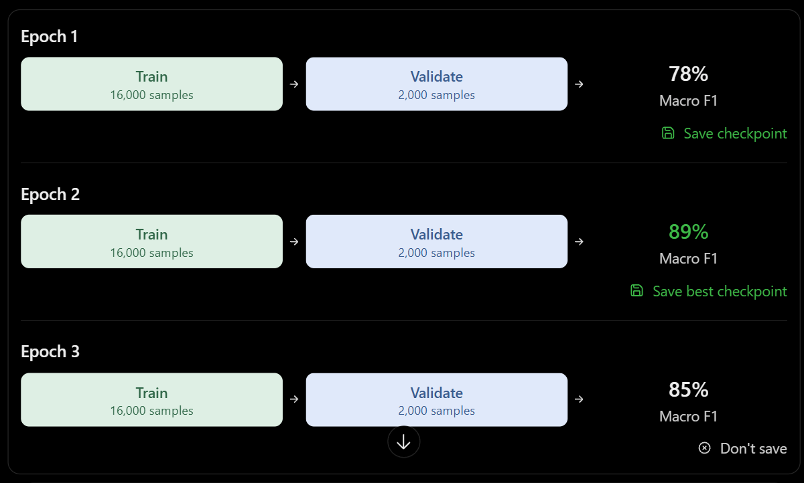

---

## 3. Model and freezing — `src/model.py`

### 3.1 Anatomy

```
                       DistilBERT backbone  (model.distilbert, ~66.4M params, pretrained)
  ┌─────────────────────────────────────────────────────────────────────────────────┐
  │ embeddings │ block 0 │ block 1 │ block 2 │ block 3 │ block 4 │ block 5 │
  └─────────────────────────────────────────────────────────────────────────────────┘
                                                                   │ [CLS] vector (768)
                                       pre_classifier 768→768 ─► ReLU ─► dropout ─► classifier 768→6
                                       └─────────── head (~0.6M params, NEW, random) ───────────┘

  Experiment A:  backbone ❄️ ❄️ ❄️ ❄️ ❄️ ❄️ ❄️      head 🔥
  Experiment B:  backbone ❄️ ❄️ ❄️ ❄️ ❄️ 🔥 🔥      head 🔥     (❄️ frozen, 🔥 trainable)
```
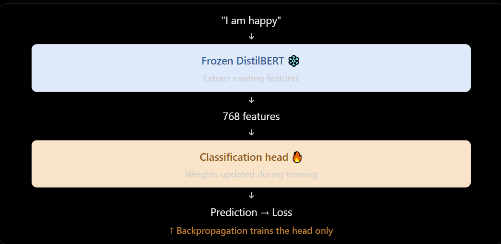

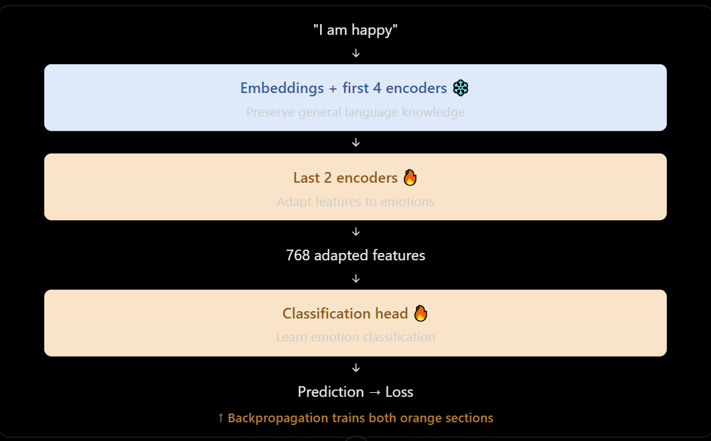

### 3.2 How freezing works in PyTorch

Every weight tensor (`nn.Parameter`) has a flag `requires_grad`. When it is `False`:
1. `loss.backward()` computes no gradient for that weight, so it saves compute and memory;
2. the optimizer has nothing to update, so the weight stays exactly as it was pretrained.

We also give the optimizer **only the trainable parameters**. AdamW keeps two extra tensors per parameter,
so leaving out frozen parameters saves a lot of memory.

### 3.3 Why only the *last* layers?

Lower layers in a Transformer tend to encode general things (sub-word meaning, syntax). Upper layers encode more
abstract, task-shaped features. Emotion is a high-level property, so adapting the top blocks gives the most
benefit for the least cost, while the bottom keeps its general language knowledge.

### 3.4 Why different learning rates?

- **A (1e-4):** only the fresh, randomly initialized head learns. It starts far from good, and nothing
  pretrained can be damaged, so a larger step size speeds it up.
- **B (2e-5):** pretrained blocks are now changing. Large steps would overwrite useful knowledge
  ("catastrophic forgetting"), so we use the standard small BERT fine-tuning rate.

---

## 4. Training loop — `src/train.py`

### 4.1 One training step, line by line

```python
inputs, labels = split_batch(batch, device)   # move tensors to GPU/CPU
logits = model(**inputs).logits               # forward pass: shape (16, 6), raw unnormalized scores
loss = loss_fn(logits, labels)                # CrossEntropy = softmax + negative log-likelihood
optimizer.zero_grad()                         # PyTorch ADDS new gradients to old ones -> reset first
loss.backward()                               # autograd: d(loss)/d(w) for every trainable w
clip_grad_norm_(model.parameters(), 1.0)      # if gradients explode, scale them down
optimizer.step()                              # w ← w − lr · AdamW_update(grad)
scheduler.step()                              # lower the learning rate a little (linear decay to 0)
```
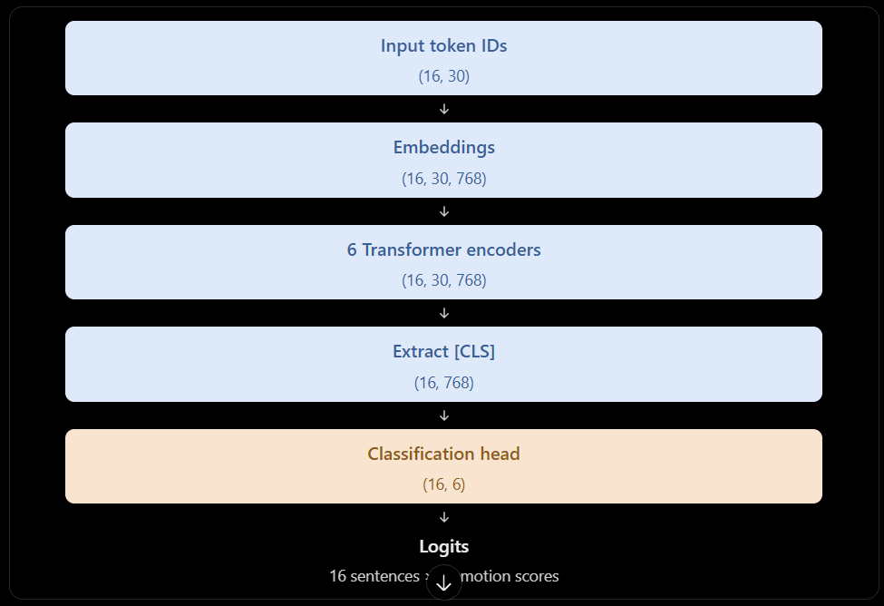

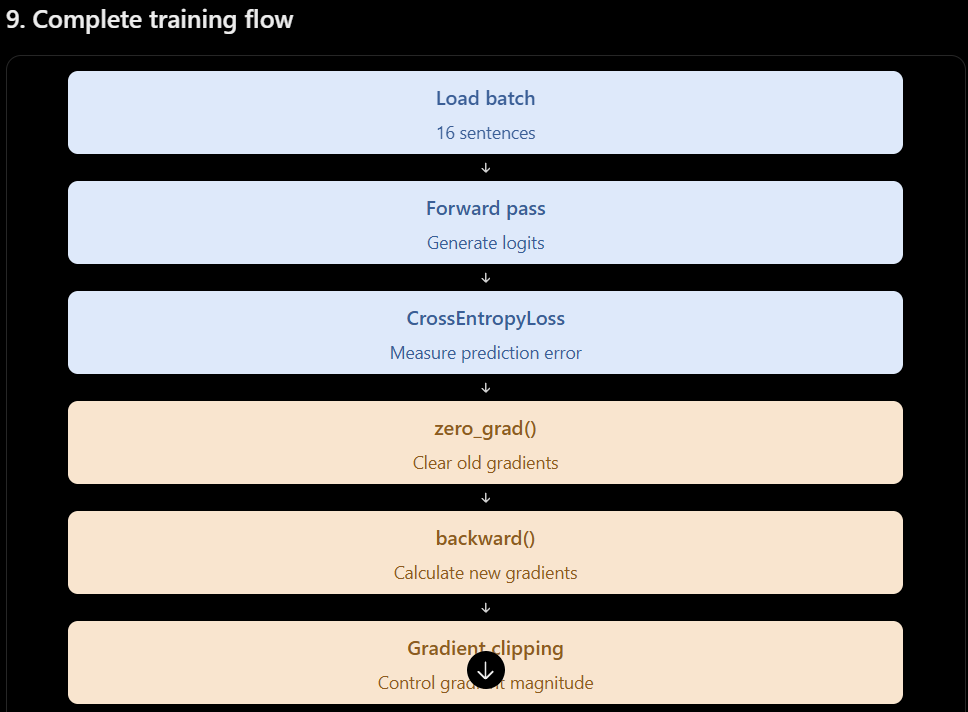


**Cross-entropy, intuitively:** the loss is `−log(probability the model gave to the correct class)`.
If the model gives the right class a probability of 0.9, the loss is 0.105. At 0.1, the loss is 2.3. The loss
punishes confident wrong answers heavily.

**Linear LR decay:** large steps early (when far from a good solution), smaller steps later (fine-tuning
the details). This makes the final epochs more stable.

### 4.2 `model.train()` vs. `model.eval()`

| | `model.train()` | `model.eval()` + `torch.no_grad()` |
|---|---|---|
| Dropout | active (randomly zeroes 10% of activations, a form of regularization) | off (deterministic outputs) |
| Gradient graph | built (needed for `backward`) | not built (faster, less memory) |
| Weights updated | yes (via `optimizer.step()`) | never |

Forgetting `model.eval()` during validation gives noisy, pessimistic scores. Forgetting `no_grad()` wastes
memory and can cause out-of-memory errors on GPU.

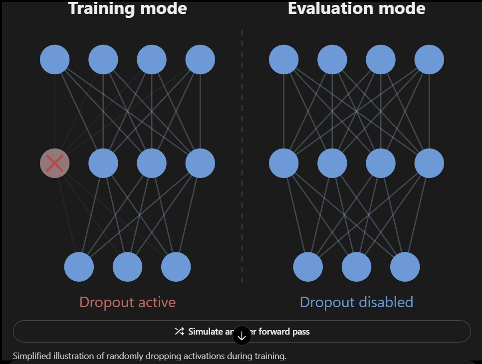

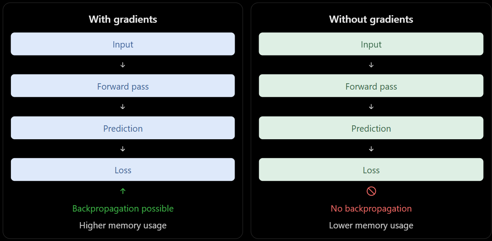

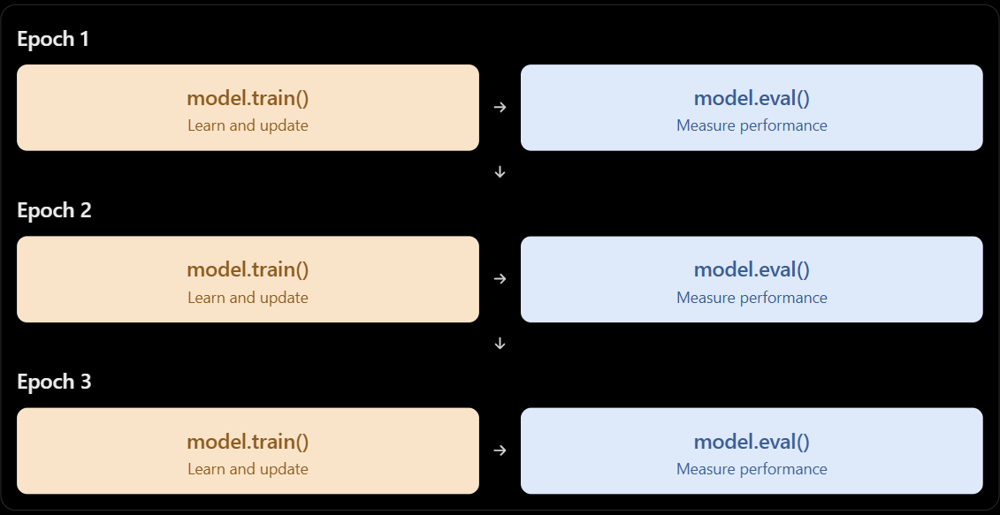

### 4.3 Model selection

After each epoch we score the validation set. If **Macro F1** beats the best so far, we save the checkpoint.
With 3 epochs, that may be epoch 3 (still improving) or an earlier one (when the model starts overfitting).
The learning curves show which case you are in:

```
loss                                   loss
 │╲  train                              │╲   train
 │ ╲___  val                            │ ╲____
 │  ╲  ‾‾‾‾‾                            │  ╲   ‾‾‾╱‾  val goes UP
 │   ╲_____                             │   ╲___    → overfitting starts
 └──────────── epoch                    └──────────── epoch
   healthy: both decrease                 checkpointing saves the earlier epoch
```
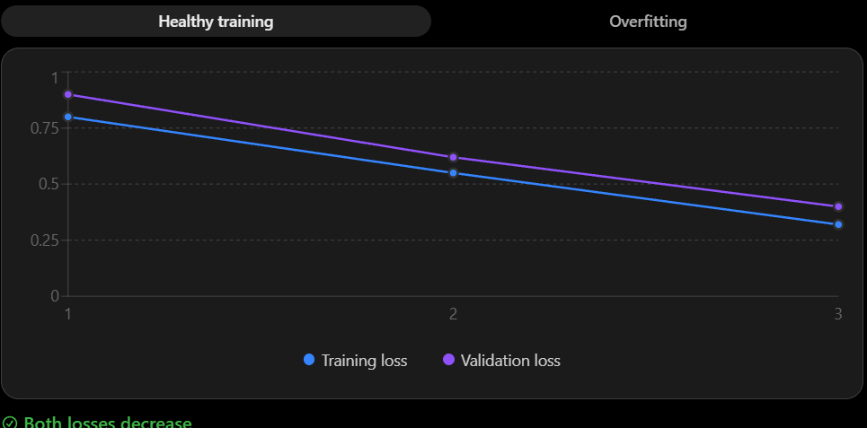
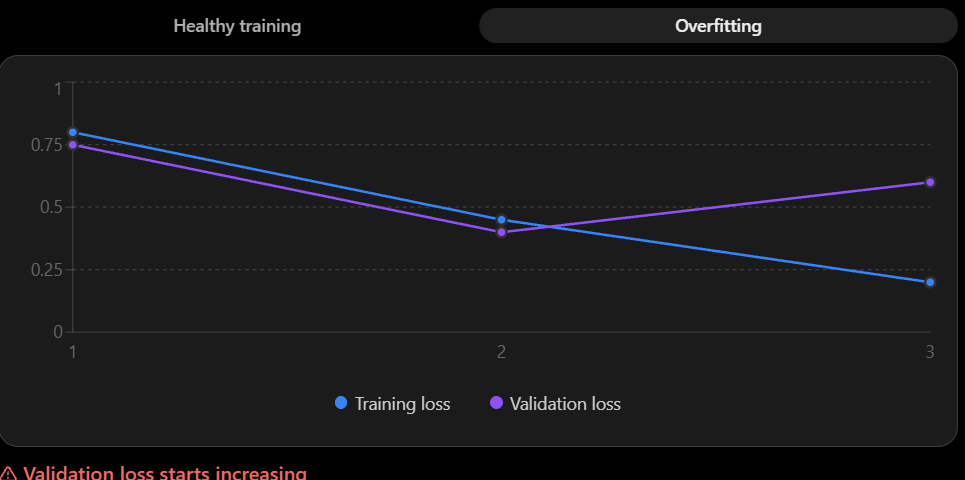

### 4.4 What we log, and why

| Logged | Answers the question |
|---|---|
| train loss | Is the model learning at all? |
| val loss / accuracy / Macro F1 | Does that learning generalize? |
| trainable parameters | How much model are we adapting? (memory + optimizer cost) |
| epoch and total seconds | What does B's improvement cost in time? |

---

## 5. Evaluation — `src/evaluate.py`

### 5.1 Metrics

For one class (say *surprise*):
- **Precision** = of everything predicted *surprise*, how much really was? (penalizes false alarms)
- **Recall** = of all real *surprise* texts, how many did we find? (penalizes misses)
- **F1** = harmonic mean of the two. It is high only if both are high.

**Macro** averaging computes F1 per class and then takes the plain average over the 6 classes, so each emotion
counts equally. **Accuracy** counts each *example* equally, so it is dominated by joy and sadness.

> Example: a model that never predicts *surprise* (a rare class) loses only a small amount of accuracy,
> but that class's F1 is 0, which drags Macro F1 down by 1/6. Macro F1 makes the failure visible.

### 5.2 Reading the confusion matrix

Rows are the **true** emotion and columns are the **predicted** emotion. The diagonal holds correct answers.
Our plot colors each cell by its share of the row (that is, recall), so rare classes are as readable as common
ones. The raw count is written in each cell. Look for the darkest **off-diagonal** cells: these are the
emotion pairs the model confuses.

### 5.3 Why the "most confident mistakes" list is valuable

`misclassified_examples.csv` is sorted by confidence. A confident mistake is usually one of three things:
- a **label-noise** case: the dataset label is arguably wrong;
- a **lexical shortcut**: the model reacts to one strong word and ignores the context;
- **genuinely mixed emotion**: the sentence really contains two emotions.

Sorting these rows into those buckets is the core of the error analysis.

---

## 6. Inference — `src/predict.py`

```python
from src.predict import predict_emotion
p = predict_emotion("I can't stop smiling today")
p.label          # "joy"
p.confidence     # e.g. 0.97
p.probabilities  # {"sadness": ..., "joy": ..., "love": ..., "anger": ..., "fear": ..., "surprise": ...}
```
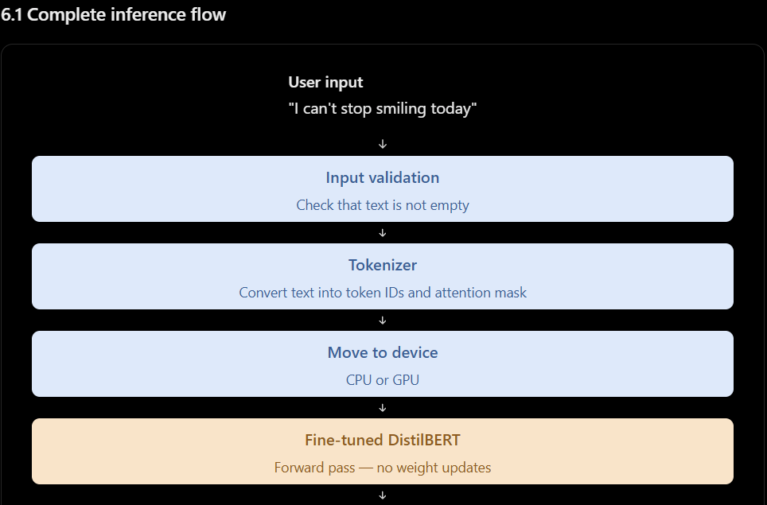
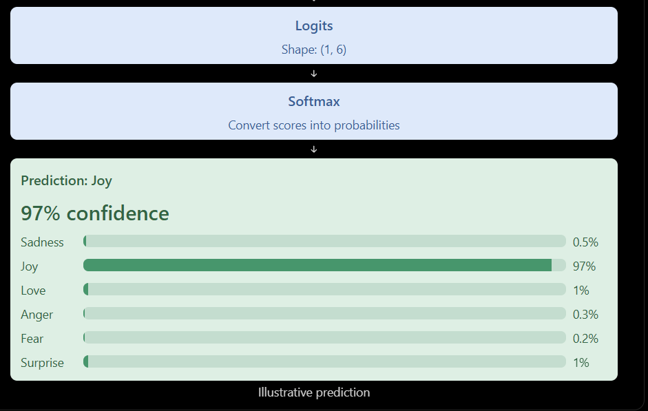

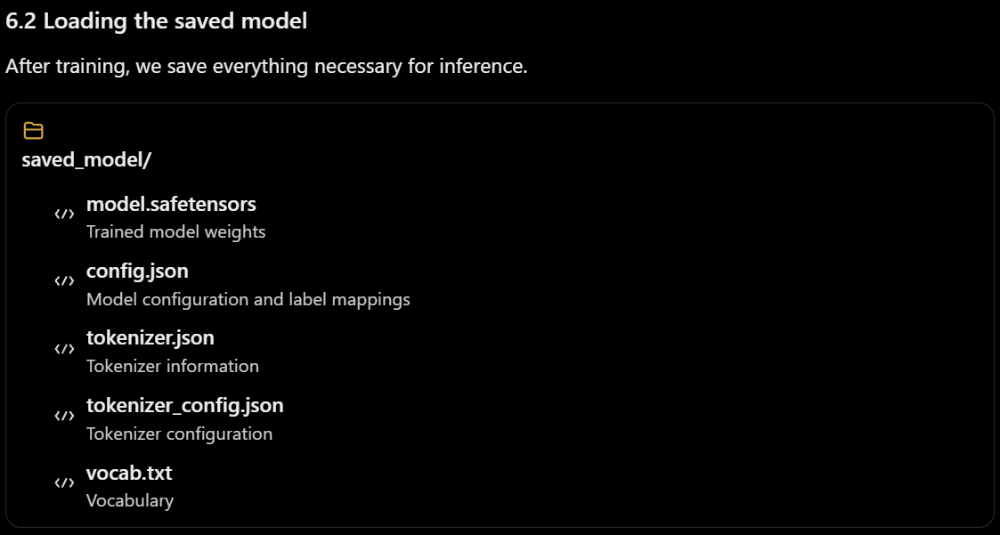
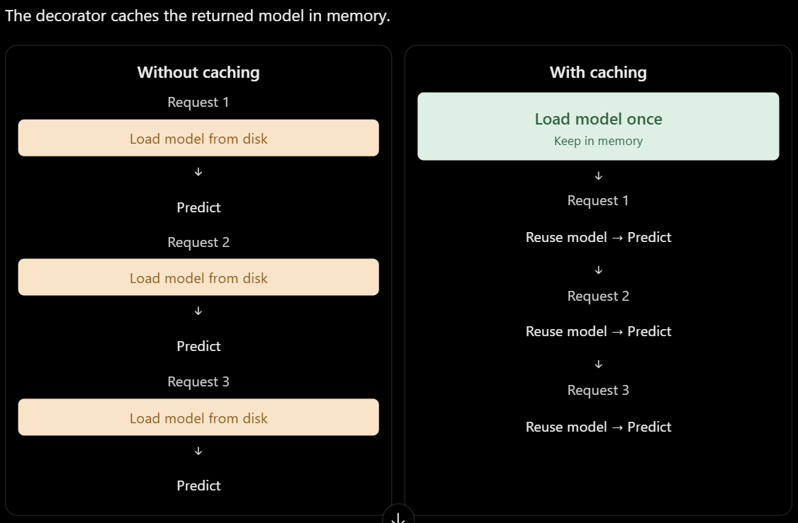

Design choices:
- **Loads everything from `saved_model/`**, including the tokenizer and label names. The serving code does not
  depend on training code or on hard-coded labels.
- **Same preprocessing as training:** same tokenizer, same `MAX_LENGTH`, truncation on. A mismatch between
  training and serving preprocessing ("training/serving skew") is a classic production bug.
- **Blank input raises `ValueError`** with a clear message. Callers (CLI, Streamlit) catch it and show it nicely.
  Failing loudly is better than returning a fake prediction.
- **`.cpu()` + `float()`** means callers always receive plain Python numbers, whatever the device.
- **`lru_cache` singleton** means repeated `predict_emotion()` calls reuse one loaded model.

---

## 7. Streamlit app — `app.py`

Streamlit's execution model is unusual: **every interaction re-runs the whole script from the top.**

```
user clicks "Predict"
   └─► script reruns from line 1
         ├─ load_classifier()      ← @st.cache_resource: returns the SAME object, no reload
         ├─ text_area(key="text")  ← value restored from st.session_state
         ├─ st.button(...) == True ← only during this one rerun
         │     └─ classifier.predict(text) → st.session_state.result
         └─ render result from st.session_state
```

- Without `@st.cache_resource`, the 255 MB model would be reloaded on every click.
- Example buttons use an `on_click` **callback**. Callbacks run *before* the rerun, which is the only safe time
  to change a widget's value (`st.session_state.text`).
- The app imports `EmotionClassifier`, so there is no duplicated tokenization or softmax code.

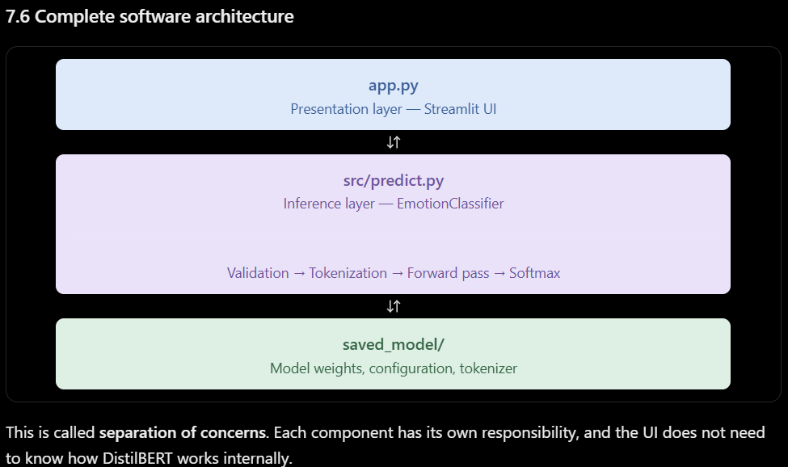
---

## 8. Common pitfalls and how this project avoids them

| Pitfall | Symptom | Where it's prevented |
|---|---|---|
| Label order mismatch | App shows plausible but wrong emotions | `config.LABELS` + assert in `eda.py` + `id2label` saved in `config.json` |
| Tuning on the test set | Over-optimistic reported score | `train.py` never loads test; best experiment chosen on validation |
| B starts from A's weights | Experiments not comparable | `build_model()` always loads fresh pretrained weights |
| Forgetting `zero_grad()` | Loss explodes or behaves erratically | explicit in `train_one_epoch` |
| Validating in train mode | Noisy validation metrics | `run_inference` calls `model.eval()` |
| Reloading the model per click | Slow app | `st.cache_resource` |
| Running `python src/train.py` | `ModuleNotFoundError: src` | Always use `python -m src.train` from the repo root |
| GPU out of memory | `CUDA out of memory` | Lower `BATCH_SIZE` in `config.py` to 8 |

---

## 9. Going further (optional ideas, not required)

Once the required work is done, these experiments deepen understanding. Each one changes one thing at a time.

1. **Unfreeze more layers** (4, then all 6). Plot Macro F1 against trainable parameters. Where do the
   returns diminish?
2. **Class-weighted loss:** `nn.CrossEntropyLoss(weight=...)` using inverse class frequencies. Does
   *surprise* recall improve? What happens to precision?
3. **Cache features for A:** with a frozen backbone, the `[CLS]` vectors never change. Compute them once
   and train the head on the cached vectors. Training becomes almost instant. Why does this trick not work for B?
4. **Calibration:** plot model confidence against actual accuracy (a reliability diagram) on the validation set.
   Is the model over-confident?
5. **Out-of-domain test:** write 20 sentences in a style that is not tweet-like (formal emails, news). How
   much does accuracy drop?

   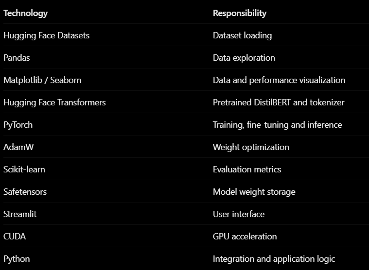
